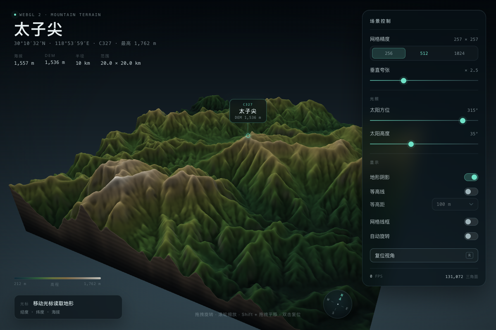
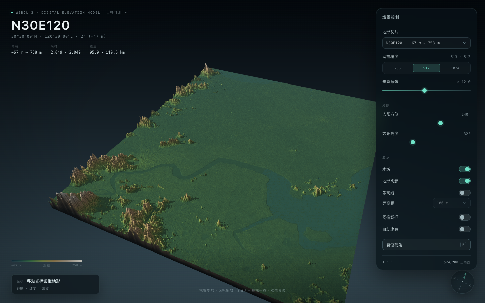

# TIF 三维地形 · 瓦片与山峰

用 WebGL 2 在浏览器中实时绘制 GeoTIFF 高程数据，包含两种入口：

- **瓦片地形**：`/`，以 `tif/N30E120.tif` 为例，展示完整 1° 瓦片。
- **山峰地形**：`/mountain/terrain/<ID>`，以给定经纬度为中心裁剪 10 km 半径的三维地形块。
  例：太子尖 `C327` → **`/mountain/terrain/C327`**。
- **批量山峰**：读取 `mountainlist_china02.json` 中全部 **1322** 座山峰，一次生成 664 MB 地形资产。





## 快速开始

页面通过 `fetch` 读取高程数据，且山峰地址需要服务端路由，因此请使用仓库自带的 `server.py`：

```bash
cd terrain
python3 server.py --port 8000
```

打开：

- 瓦片地形：<http://127.0.0.1:8000/>
- 太子尖：<http://127.0.0.1:8000/mountain/terrain/C327>
- 玉山：<http://127.0.0.1:8000/mountain/terrain/T1>

> 当前工作区已有一个服务运行在 <http://127.0.0.1:8765/>。
> 普通的 `python3 -m http.server` 只能浏览静态文件，**不会**处理
> `/mountain/terrain/<ID>` 这样的山峰路由。

浏览器要求：支持 WebGL 2 与 `R16F` 纹理（Chrome / Edge / Safari 15+ / Firefox）。

## 山峰模式

### 生成一套山峰文件

```bash
python3 scripts/make_mountain.py \
  --id C327 \
  --name 太子尖 \
  --lon 118.89967 \
  --lat 30.17559 \
  --radius 10 \
  --size 513
```

参数：

| 参数 | 说明 |
| --- | --- |
| `--id` | 山峰 ID，只能使用字母、数字、`_`、`-`，用于 URL |
| `--name` | 显示名称，默认使用 ID |
| `--lon` / `--lat` | 山峰经纬度（WGS84） |
| `--radius` | 半径 km，默认 10；输出为 `2×radius` 的方形区域 |
| `--size` | 输出采样数，默认 1025（自动调整为奇数，保证峰值在中心像素） |
| `--smooth` | 二项式平滑次数，默认 2；`0` 保留原始值 |
| `--tif-dir` | 源 1° 瓦片目录，默认 `tif` |
| `--out` | 输出目录，默认 `data/mountains` |

生成结果：

```
data/mountains/C327/
├── heightmap.f16   # 513 × 513 float16，行序从北到南（约 0.5 MB）
└── meta.json       # 中心点、边界、峰值、最高点、源瓦片、生成时间…
data/mountains/catalog.json   # 自动更新，仅供数据维护（页面不再读取）
```

生成脚本会自动：

1. 按半径计算经纬度包围盒；
2. 查找并读取覆盖该范围的 1° TIF 瓦片（C327 同时跨 `N30E118` 和 `N30E119`，会自动拼接）；
3. 以山峰为中心建立 **以米为单位的正方形采样网格**（20 km × 20 km），逐点反算经纬度并做双线性采样；
4. 处理 nodata / 缺测填充，做轻度平滑；
5. 记录峰值、裁剪区域最高点、边界、源瓦片等信息；
6. 更新 catalog，供数据维护使用（页面不展示其他山峰入口）。

### 批量生成 JSON 中的所有山峰

仓库已按 `mountainlist_china02.json` 生成全部 **1322** 座山峰（470 块 1° 瓦片，约 **664 MB**）：

```bash
python3 scripts/batch_mountains.py \
  --json /Users/xueping/Workspace/wenduji_16/app/src/main/assets/mountainlist_china02.json \
  --size 513
```

- 默认 `--size 513`：约 0.5 MB/峰；`--size 1025`：约 2.1 MB/峰（总约 2.8 GB）；
  若要打进 Android assets，可用 `--size 257`（约 170 MB）。
- 源瓦片使用小型 LRU 缓存，峰值按空间顺序处理；1322 座在本机约 2 分钟。
- `--skip-existing` 可断点续跑；`--limit N` 只跑前 N 座；`--dry-run` 只检查瓦片覆盖。
- JSON 中的 `height`（标注海拔）、`timezone`、`source`、`elevations` 会写入 `meta.json`，
  页面同时显示 **标注海拔** 与 **DEM 采样峰值**。
- catalog 只在批量结束时写一次，仅供数据维护；新增山峰后直接访问其 URL 即可。

> C327 的标注海拔为 1,557 m，SRTM 在峰顶坐标处采样约 1,536 m；10 km 区域最高点约 1,762 m。
> 这是 30 m DEM 与平滑造成的正常差异，页面会把两者都显示出来。

### 打开山峰页面

```
/mountain/terrain/C327
```

页面加载 `/data/mountains/C327/meta.json` 与 `heightmap.f16`，并把山峰标记投影到屏幕上。
地址中的 ID 与目录名一一对应；新增山峰后无需重启服务，直接访问对应 URL 即可。
页面只显示当前山峰，不提供山峰列表、搜索、下拉切换或其他山峰入口。

### 页面特性

- **山峰标记**：中心点上方显示名称、ID、DEM 海拔，并随相机实时投影。
- **标注海拔 vs DEM**：页面显示 JSON 中的官方/标注海拔，以及 DEM 在峰顶的采样值。
- **相对高程配色**：裁剪区域的配色按自身 `min/max` 归一化，不会因为区域整体海拔偏高而变成“雪山”。
- **垂直夸张**：默认 2.5×，可调 1–6×；相机目标高度会随夸张系数自动调整。
- **地形阴影 / 等高线 / 线框 / 自动旋转**。
- **光标读数**：经纬度、海拔、距视点距离。
- **单一山峰页面**：不显示山峰下拉框、列表页或“其他山峰”链接；仅通过 ID 地址访问。

### 服务端路由

| 路由 | 行为 |
| --- | --- |
| `/` | 瓦片地形查看器 |
| `/mountain/terrain/<ID>` | 山峰查看器；`<ID>` 未生成时返回 404 页面 |
| `/mountain/terrain` | 返回 404 提示，不列出任何山峰 |
| `/data/mountains/<ID>/...` | 生成的高程与元数据 |
| `/data/...`、`/js/...` 等 | 静态资源 |

## 瓦片模式

原始 `tif/N30E120.tif` 为 3601 × 3601、int16、LZW、WGS84、1″ 采样。
示例资产做了轻度平滑和降采样：

```bash
python3 scripts/tif2terrain.py tif/N30E120.tif --smooth 2 --max-size 2049
```

- `data/N30E120.f16`：2049 × 2049 float16（8 MB）；
- `data/N30E120.json`：边界、中心、高程范围、分辨率；
- `data/manifest.json`：瓦片清单，页面下拉框读取。

需要完整 3601 × 3601 分辨率时：

```bash
python3 scripts/tif2terrain.py tif/N30E120.tif --smooth 0 --max-size 0
```

批量转换相邻瓦片后刷新页面即可切换：

```bash
python3 scripts/tif2terrain.py tif/N30E120.tif tif/N31E120.tif
```

## 交互

| 操作 | 功能 |
| --- | --- |
| 左键拖拽 | 旋转 |
| 滚轮 / 双指捏合 | 缩放 |
| 右键拖拽 / Shift + 左键拖拽 | 平移 |
| 双击 / `R` | 复位视角 |
| 点击方位罗盘 | 视角转到上北下南、左西右东（保留俯仰与缩放） |
| 鼠标移动 | 读取光标经纬度、海拔、距离 |
| `1` / `2` / `3` | 256 / 512 / 1024 网格 |
| `W` | 线框 |
| `C` | 等高线 |
| `S` | 地形阴影 |
| `Space` | 自动旋转 |

## 实现要点

- **WebGL 2**，无第三方库/CDN。高程以 `R16F` 浮点纹理上传，顶点着色器采样并做垂直位移。
- 片元着色器计算坡向光照、曲率环境光遮蔽，并沿太阳方向对高度场做 28 步光线步进得到地形阴影。
- 海岸瓦片使用绝对高程配色；山峰模式使用基于裁剪范围的相对配色。
- 等高线用屏幕空间导数做抗锯齿，并按像素密度淡出，避免远处摩尔纹。
- 地形块四周生成切面侧壁，读起来是一块实心地形而不是薄片。
- 相机为阻尼球面轨道相机；山峰模式支持围绕峰值高度旋转。
- 光标拾取：视图射线与 DEM 做 1400 步粗步进 + 26 次二分，返回经纬度和实际海拔。
- 生成器按米制正方形网格反算经纬度，避免 10 km 区域在经度方向被压缩。

## 目录结构

```
index.html                 瓦片地形页面
mountain.html              山峰地形页面
server.py                  静态服务 + 山峰路由
css/style.css              通用深色 UI
css/mountain.css           山峰标记与通用页面样式
js/app.js                  瓦片页面逻辑
js/mountain.js             山峰页面逻辑
js/renderer.js             WebGL 渲染器、网格、纹理、水面、线框
js/shaders.js              地形 / 天空 / 水面 / 线框 GLSL
js/camera.js               阻尼轨道相机
js/mat4.js                 列主序矩阵运算
js/picking.js              float16 解码、双线性采样、射线拾取
js/terrain.js              manifest / 元数据 / 二进制加载
scripts/tif2terrain.py     1° TIF → 瓦片资产
scripts/make_mountain.py   经纬度 + ID → 单座山峰资产
scripts/batch_mountains.py 山峰列表 JSON → 批量山峰资产
data/N30E120.*             瓦片示例资产
data/mountains/<ID>/*      1322 座山峰资产（heightmap + meta）
data/mountains/catalog.json  1322 条山峰索引（维护用）
docs/preview.png           瓦片预览
docs/preview-mountain.png  山峰预览
tif/                       原始 GeoTIFF 瓦片（未改动）
```

## 性能提示

默认 512 网格 + 28 步地形阴影：

- 集成显卡或高分屏掉帧时，可切换到 256 网格、关闭阴影/等高线；
- 单座山峰资产约 0.5 MB（513²），加载和上传比整块 1° 瓦片轻很多；全部 1322 座约 664 MB；
- 无头 Chrome 的 SwiftShader 软件渲染截图只有 1–3 fps，这是软件光栅化限制，不代表真实 GPU 表现。
